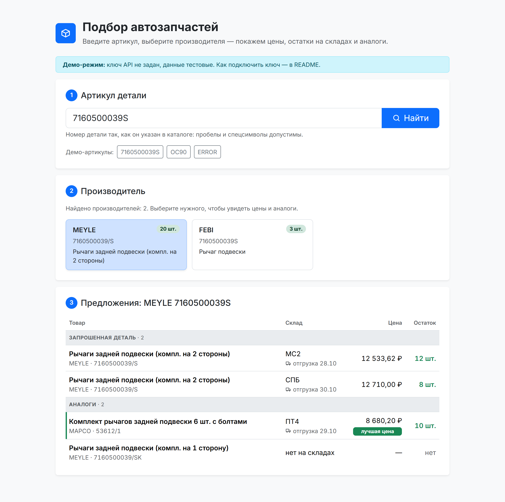
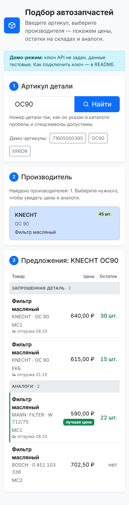

# Подбор автозапчастей

Клиентское приложение на React + Redux для API поиска автозапчастей: двухэтапный подбор детали.

1. **Производитель.** Вводим артикул → запрос `?number=…` → список брендов, у которых есть деталь с этим номером.
2. **Предложения и аналоги.** Выбираем бренд → запрос `?number=…&brand=…&analogues=on` → таблица: название и производитель, склад, цена, остаток. Запрошенная деталь и аналоги — отдельными группами.

<p>
  
  
</p>

## Стек

React 18, Redux Toolkit + react-redux, Bootstrap 5, Vite, шрифт Inter. Без TypeScript.
Для разработки: ESLint, Prettier, Vitest.

## Запуск

```bash
npm install
cp .env.example .env    # впишите ключ покупателя в PARTS_API_KEY
npm run dev
```

**Демо-режим.** Если ключа нет, приложение работает на тестовых данных в формате API. Под полем поиска есть кнопки с артикулами: `7160500039S` и `OC90` — есть данные, `ERROR` — ошибка API, любой другой — «ничего не найдено».

Другие команды:

| Команда                | Что делает                                      |
| ---------------------- | ----------------------------------------------- |
| `npm run build`        | сборка в `dist/`                                |
| `npm run preview`      | просмотр сборки (с тем же прокси, что и в dev)  |
| `npm test`             | тесты Vitest                                    |
| `npm run lint`         | ESLint                                          |
| `npm run format:check` | проверка Prettier (`npm run format` — исправит) |

## Как устроено

```
src/
  api/partsApi.js        запрос к API, кодирование параметров, разбор ответа и ошибок
  api/mock.js           демо-данные для запуска без ключа
  store/searchSlice.js  состояние двух этапов: thunk-и fetchBrands и fetchOffers
  store/selectors.js    селекторы, в том числе мемоизированный «лучшая цена»
  components/           SearchForm, BrandList, OffersTable — три шага подбора;
                        Section, Skeleton, ErrorAlert, Icon, ErrorBoundary — общие
```

## Решения и почему так

- **Ключ живёт только в прокси.** API работает по http и без CORS, поэтому браузер всё равно ходит через прокси Vite (`/api` → сервер API). Прокси и подставляет ключ из `PARTS_API_KEY`. Переменная без префикса `VITE_`, поэтому в JS-бандл ключ не попадает и в DevTools его не увидеть. Для боевого размещения нужен такой же обратный прокси (например, nginx).
- **Цена и остаток — из `warehouses`.** Поле `price` у товара документация использовать запрещает. Одна строка таблицы — товар на конкретном складе, рядом дата отгрузки. Товар без складов показан строкой «нет на складах».
- **Данные нормализуются в сторе.** Цена и остаток могут прийти строкой — приводятся к числу; цена 0 или мусор показывается прочерком, а не «0 ₽» и не «NaN ₽». Компоненты получают готовые строки таблицы.
- **Ошибки.** Сбой сети, таймаут (15 с), HTTP-ошибка, не-JSON, поле `error` (строка или массив). Ошибки из документации переведены на русский. Текст ошибки API показывается, даже если он пришёл с HTTP 403 — так реальный API отвечает на неверный ключ.
- **«Не найдено».** API возвращает массив с одним пустым товаром — он отфильтровывается, и пользователь видит «ничего не найдено», а не бренд с пустым названием.
- **Кодирование параметров** через `encodeURIComponent`: документация требует кодировать `#`, `&` и т. п., а `URLSearchParams` превратил бы пробел в `+` вместо `%20`.
- **Гонки и повторные клики.** Ответ на устаревший запрос отбрасывается сверкой `requestId`, поэтому новый артикул можно искать прямо во время загрузки. Тот же самый запрос, пока он в полёте, повторно не отправляется (`condition` в thunk-ах) — бережём квоту.
- **Поиск по Enter или кнопке**, а не на каждое нажатие клавиши — по той же причине.
- **Лучшая цена.** Самое дешёвое предложение, которое есть в наличии, отмечено в таблице. Считается мемоизированным селектором (`createSelector`): пересчёт только при новых данных.
- **Ошибки рендера** ловит `ErrorBoundary` — единственный классовый компонент: у хуков нет аналога `getDerivedStateFromError`. Вместо белого экрана пользователь видит сообщение и кнопку обновления.

## Вёрстка

- **Bootstrap + небольшой `index.css`** на CSS-переменных Bootstrap (`--bs-*`): цвета, радиусы и тени в одном стиле, без переопределения компонентов.
- **Адаптив.** Бренды — сетка на CSS Grid (`repeat(auto-fill, minmax(min(100%, 15rem), 1fr))`): 1–3 колонки без медиазапросов. На телефоне колонка «Склад» переносится в ячейку товара, и таблица помещается без горизонтальной прокрутки. После выбора бренда страница прокручивается к результатам (с учётом `prefers-reduced-motion`).
- **Шрифт Inter** подключён локально (`@fontsource-variable/inter`): один вариативный файл на все начертания, браузер скачивает только нужные наборы символов (`unicode-range`: латиница и кириллица), `font-display: swap` — текст виден сразу.
- **Иконки** — свои линейные SVG в компоненте `Icon`, без иконочного шрифта: в бандл попадают только используемые, цвет от `currentColor`, размер от шрифта.
- **Загрузка** показана скелетонами (`placeholder-glow` из Bootstrap) в форме будущего контента — страница не «прыгает», когда приходят данные.
- **Доступность.** Подпись у поля, `role="search"`, `aria-pressed` у карточек брендов, видимый фокус с клавиатуры, `role="status"` у загрузки и «ничего не найдено», `role="alert"` у ошибок, `caption` и `scope` в таблице, декоративные иконки скрыты от скринридеров.

## Тесты: что и зачем проверяю

Тестирую логику, на которой легко ошибиться и которую неудобно проверять руками, а не разметку:

- **API-слой** (`partsApi.test.js`): текст ошибки API при HTTP 403 (так реальный API отвечает на неверный ключ), кодирование `#`, `&` и пробела, сбой сети, ответ «не найдено» (массив с пустым товаром), несколько ошибок сразу.
- **Стор** (`searchSlice.test.js`): ответ на устаревший запрос игнорируется, повтор после ошибки сбрасывает её, двойной клик не отправляет второй запрос, строки таблицы собираются из складов (числа из строк, товар без складов).
- **Селектор** (`selectors.test.js`): «лучшая цена» не достаётся товару без остатка, не ставится, если сравнивать не с чем, и не пересчитывается без новых данных.

Сеть в тестах подменяется (`vi.stubGlobal('fetch')`, `vi.mock`), поэтому они быстрые и не зависят от ключа и квоты API.

## Что можно сделать дальше

- Параметр `info=on` и пометка «невозвратная позиция» (`notRefund`).
- Тест пользовательского сценария через React Testing Library.
- Сортировка и фильтр таблицы (только в наличии, по цене).
- Обновление Vite до актуальной мажорной версии: `npm audit` предупреждает об уязвимости esbuild в dev-сервере (на сборку не влияет).
