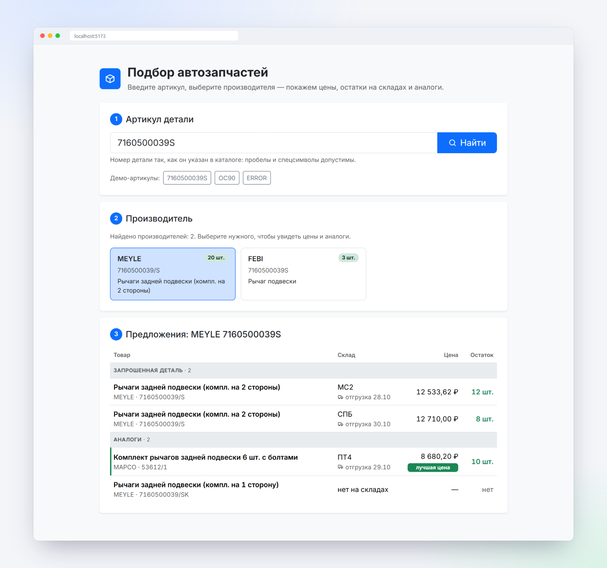
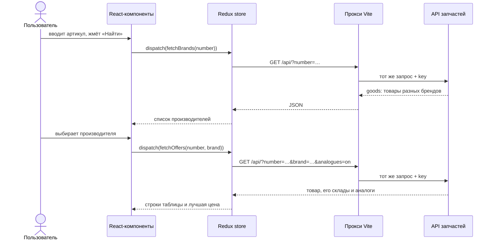
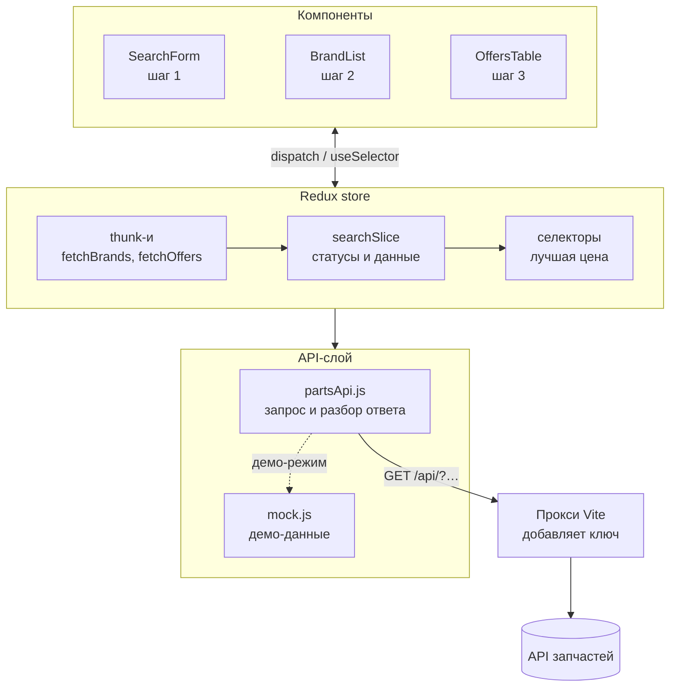
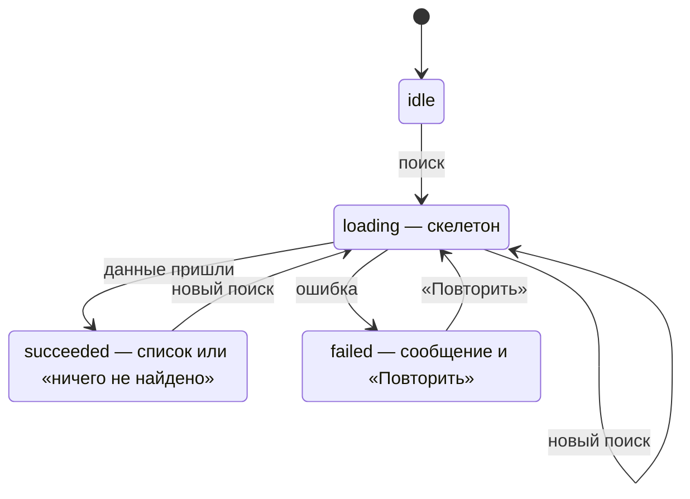
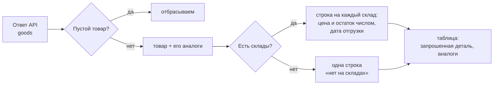
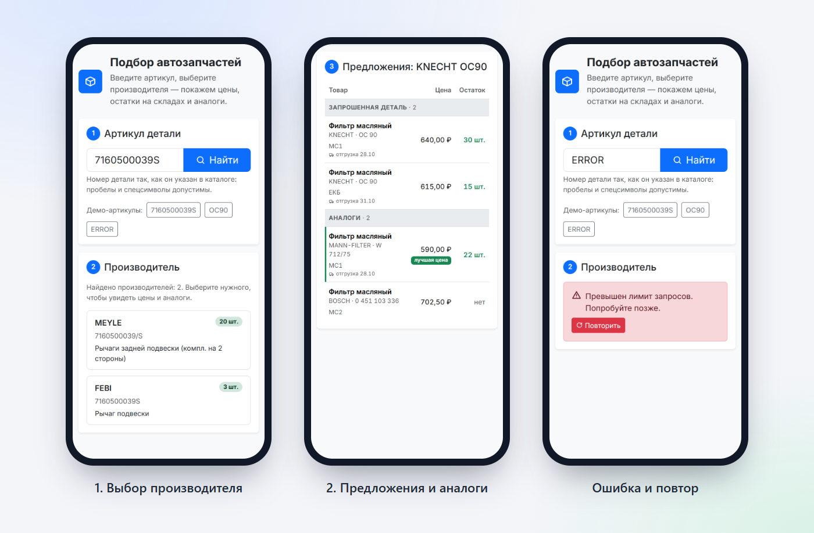

# Подбор автозапчастей

Веб-приложение для поиска автозапчастей по артикулу: показывает производителей детали, а затем цены, остатки на складах и аналоги выбранной позиции.




## Содержание

- [Возможности](#возможности)
- [Быстрый старт](#быстрый-старт)
- [Как это работает](#как-это-работает)
- [Архитектура](#архитектура)
- [Работа с API](#работа-с-api)
- [Вёрстка и UX](#вёрстка-и-ux)
- [Тесты](#тесты)
- [Ключевые решения](#ключевые-решения)
- [Команды](#команды)

## Возможности

- **Двухэтапный подбор.** Артикул → список производителей → цены, остатки и аналоги выбранного бренда.
- **Цены и остатки по складам.** Каждая строка таблицы — предложение конкретного склада с датой отгрузки. Самое дешёвое предложение в наличии отмечено как «лучшая цена».
- **Аккуратная обработка ошибок.** Сбой сети, таймаут, ошибка сервера, ошибка API, пустой ответ — у каждого случая понятное сообщение и кнопка «Повторить».
- **Без гонок и лишних запросов.** Ответ на устаревший запрос отбрасывается, а повторный клик не отправляет дубль.
- **Адаптивная вёрстка.** От телефона до широкого экрана без горизонтальной прокрутки.
- **Доступность.** Подписи, ARIA-состояния, видимый фокус, озвучивание загрузки и ошибок.
- **Демо-режим.** Без ключа API приложение работает на тестовых данных в формате реального API.

## Быстрый старт

Нужен Node.js 18+.

```bash
npm install
npm run dev
```

Откройте http://localhost:5173. Без настроек включается **демо-режим**: под полем поиска есть кнопки с артикулами.

| Артикул       | Что покажет                                      |
| ------------- | ------------------------------------------------ |
| `7160500039S` | два производителя, аналоги, товар без складов    |
| `OC90`        | один производитель, аналоги, позиция без остатка |
| `ERROR`       | ошибку API с кнопкой «Повторить»                 |
| любой другой  | «ничего не найдено»                              |

Для работы с настоящим API скопируйте `.env.example` в `.env` и заполните адрес и ключ:

```bash
cp .env.example .env
```

```ini
PARTS_API_URL=http://адрес-api/путь/
PARTS_API_KEY=ключ-покупателя
```

## Как это работает

Пользователь проходит три шага, каждый — отдельная карточка на странице. Запросы уходят только по Enter или кнопке, а не на каждое нажатие клавиши: у API есть лимит запросов.



## Архитектура



Компоненты ничего не знают о формате API: они получают из стора готовые данные. API-слой ничего не знает о React: это обычные функции, которые легко тестировать.

```
src/
  api/
    partsApi.js          запрос, кодирование параметров, разбор ответа и ошибок
    mock.js              демо-данные в формате API
  store/
    searchSlice.js       состояние двух этапов, thunk-и, сборка строк таблицы
    selectors.js         селекторы, в том числе мемоизированная «лучшая цена»
  components/
    SearchForm.jsx       шаг 1: поле артикула
    BrandList.jsx        шаг 2: карточки производителей
    OffersTable.jsx      шаг 3: таблица предложений и аналогов
    Section.jsx          карточка шага с номером и заголовком
    Skeleton.jsx         скелетоны загрузки
    ErrorAlert.jsx       ошибка с кнопкой «Повторить»
    Icon.jsx             SVG-иконки
    ErrorBoundary.jsx    защита от ошибок рендера
  index.css              немного своих стилей поверх Bootstrap
```

### Состояние запроса

У каждого этапа своё состояние `{ status, error, items, requestId }`, и интерфейс показывает ровно то, что соответствует статусу.



**Гонки запросов.** Каждый запуск thunk-а получает свой `requestId`, и стор запоминает id последнего запроса. Если пользователь начал новый поиск, не дождавшись старого, ответ на старый запрос не совпадёт по id и будет отброшен. Поэтому искать новый артикул можно прямо во время загрузки.

**Повторные клики.** У thunk-ов есть `condition`: тот же самый запрос, пока он выполняется, второй раз не отправляется. Двойной клик или Enter вместе с кнопкой не тратят квоту API.

## Работа с API

API принимает GET-запрос и отвечает JSON-ом `{ goods: [...] }` или `{ error: ... }`.

| Параметр    | Когда передаётся | Зачем                                       |
| ----------- | ---------------- | ------------------------------------------- |
| `key`       | всегда           | ключ покупателя, добавляет прокси           |
| `number`    | всегда           | артикул                                     |
| `brand`     | этап 2           | производитель                               |
| `analogues` | этап 2, `on`     | вернуть аналоги (работает только с `brand`) |

Как обрабатываются ответы:

| Ситуация                             | Что видит пользователь                                 |
| ------------------------------------ | ------------------------------------------------------ |
| Нет сети                             | «Нет связи с сервером. Проверьте подключение…»         |
| Сервер не ответил за 15 секунд       | «Сервер не ответил вовремя…»                           |
| `{ error: "..." }` или массив ошибок | текст ошибки, известные ошибки переведены на русский   |
| Ошибка API пришла с HTTP 403         | всё равно текст ошибки, а не просто «ошибка 403»       |
| HTTP-ошибка без JSON                 | «Сервер ответил ошибкой 500»                           |
| Ответ не JSON                        | «Сервер вернул некорректный ответ»                     |
| `goods` с одним пустым товаром       | «ничего не найдено» — так API сообщает, что товара нет |

### От ответа к строкам таблицы

Цена и остаток в API указаны **по складам**, а поле `price` у самого товара документация API использовать запрещает. Поэтому стор разворачивает ответ в строки «товар × склад»:



- Цена и остаток иногда приходят строкой (`"8680.20"`) — приводятся к числу. Цена 0 или мусор показывается прочерком, а не «0 ₽» и не «NaN ₽».
- Дата отгрузки берётся из строки как есть, без перевода в часовой пояс браузера.
- Ключ строки — позиция в ответе: пара «бренд + номер» не уникальна (один товар лежит на нескольких складах).
- Номер и бренд кодируются через `encodeURIComponent`: API требует кодировать `#`, `&` и другие спецсимволы, а `URLSearchParams` превратил бы пробел в `+`.

## Вёрстка и UX



- **Bootstrap 5 и небольшой `index.css`.** Свои стили построены на CSS-переменных Bootstrap (`--bs-*`), поэтому цвета, радиусы и тени остаются в одном стиле. Компоненты Bootstrap не переопределяются.
- **CSS Grid для карточек брендов:** `repeat(auto-fill, minmax(min(100%, 15rem), 1fr))` раскладывает их в 1–3 колонки без медиазапросов, а `min(100%, …)` не даёт карточке вылезти за край на узком экране.
- **Таблица на телефоне.** Колонка «Склад» скрывается и переезжает в ячейку товара, шрифт чуть уменьшается — таблица помещается без горизонтальной прокрутки. Цифры моноширинные (`tabular-nums`), поэтому цены ровно встают в столбец.
- **Скелетоны вместо спиннера.** Заглушки повторяют форму будущего контента, поэтому страница не «прыгает», когда приходят данные.
- **Шрифт Inter** подключён локально: вариативный файл на все начертания, браузер скачивает только нужные наборы символов (`unicode-range`), `font-display: swap` показывает текст сразу.
- **Иконки — свои SVG** без иконочного шрифта: в бандл попадают только используемые, цвет от `currentColor`, размер от шрифта.
- **Мелочи, которые экономят время:** после выбора бренда страница прокручивается к результатам (с учётом `prefers-reduced-motion`), активный бренд подсвечен, лучшая цена отмечена полосой и бейджем.
- **Доступность:** подпись у поля, `role="search"`, `aria-pressed` у карточек брендов, видимый фокус с клавиатуры, `role="status"` у загрузки и пустого результата, `role="alert"` у ошибок, `caption` и `scope` в таблице. Декоративные иконки скрыты от скринридеров.

## Тесты

```bash
npm test
```

Тестирую логику, в которой легко ошибиться и которую неудобно проверять руками. Разметку и стили не тестирую: их надёжнее проверять глазами на разных экранах.

| Файл                  | Что проверяет                                                                                      | Почему это важно                                           |
| --------------------- | -------------------------------------------------------------------------------------------------- | ---------------------------------------------------------- |
| `partsApi.test.js`    | ошибка API при HTTP 403, кодирование `#`, `&` и пробела, сбой сети, «не найдено», несколько ошибок | именно здесь чужой формат данных встречается с нашим кодом |
| `searchSlice.test.js` | устаревший ответ игнорируется, повтор после ошибки, двойной клик, сборка строк из складов          | гонки и дубли почти невозможно поймать вручную             |
| `selectors.test.js`   | лучшая цена не достаётся товару без остатка, метки нет, если сравнивать не с чем, мемоизация       | ошибка здесь вводит покупателя в заблуждение               |

Сеть подменяется (`vi.stubGlobal('fetch')`, `vi.mock`), поэтому тесты быстрые и не зависят от ключа и лимита запросов.

## Ключевые решения

**Ключ API не попадает в браузер.** API работает по http и без CORS, поэтому браузер всё равно обращается к нему через прокси (`/api`). Прокси и подставляет ключ из `PARTS_API_KEY`. Переменные без префикса `VITE_` Vite не встраивает в бандл, поэтому ключа нет ни в JS, ни в DevTools. На боевом сервере ту же роль играет обратный прокси, например nginx.

**Данные нормализуются в сторе, а не в компонентах.** Компоненты получают готовые строки с числами и ключами. Странные данные (строки вместо чисел, нули, нет складов) обрабатываются в одном месте и покрыты тестами без React.

**Сначала разбор JSON, потом HTTP-статус.** Иначе потерялась бы понятная причина ошибки: на неверный ключ API отвечает кодом 403 и текстом ошибки в теле ответа.

**Классовый компонент — только `ErrorBoundary`.** У хуков нет аналога `getDerivedStateFromError`, а без него ошибка рендера превращается в белый экран.

**Минимум зависимостей.** React, Redux Toolkit, Bootstrap и шрифт. Без роутера, React Query и UI-китов: для двух экранов подбора они добавили бы сложности больше, чем пользы.

## Команды

| Команда           | Что делает                      |
| ----------------- | ------------------------------- |
| `npm run dev`     | dev-сервер с прокси к API       |
| `npm run build`   | сборка в `dist/`                |
| `npm run preview` | просмотр сборки с тем же прокси |
| `npm test`        | тесты Vitest                    |
| `npm run lint`    | ESLint                          |
| `npm run format`  | Prettier                        |

## Что можно развить

- Пометка «невозвратная позиция» (параметр `info=on`, поле `notRefund`).
- Сортировка и фильтры таблицы: только в наличии, по цене, по сроку отгрузки.
- Тест пользовательского сценария через React Testing Library.
- Обновление Vite до новой мажорной версии: `npm audit` предупреждает об уязвимости esbuild в dev-сервере (на сборку не влияет).
